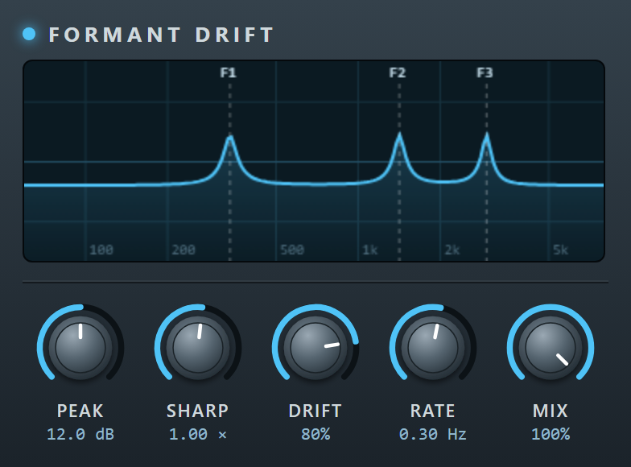

# Formant Drift
声のフォルマントにあたる 3 つの山が、ゆっくりランダムに揺らぎながら変わっていく Web Audio Module（WAM2）のエフェクト。WeVocal 専用ではなく、WAM2 に対応するホストならどれでも読み込める。

- ID: `net.pitan76.formantdrift`
- 種別: エフェクト（音声の入力と出力。MIDI は使わない）



## つまみ
| 名前 | 範囲 | 内容 |
| --- | --- | --- |
| Peak | 0〜24 dB | 山の高さ |
| Sharp | 0.3〜3 | 山の鋭さ（Q に掛ける倍率） |
| Drift | 0〜1 | 山の揺れる幅。1 で動ける範囲いっぱいまで動く |
| Rate | 0.02〜3 Hz | 目標を決め直す速さ |
| Mix | 0〜1 | 効果音の割合 |

## しくみ
母音のフォルマント（F1 280〜900 Hz、F2 800〜2700 Hz、F3 2300〜3600 Hz）の範囲に、3 つのピーキングフィルターを直列に置く。`Rate` に合わせて、山ごとに新しい目標の周波数をランダムに選び、`setTargetAtTime` で滑らかに近づける。山を足すと音量が上がるので、`Peak` に応じて出力を下げている。

## 開発
```sh
npm ci
npm run build   # dist/index.js と dist/descriptor.json を作る（SDK を同梱した ES モジュール）
npm test   # Chrome（headless）で、音が出てスペクトルが動くこと、つまみの値が読み書きできること、画面のつまみの操作が戻らないことを確かめる
npm run screenshot   # 画面を撮り直して screenshot.png に保存する
```

main に push すると、GitHub Actions が `dist/` を GitHub Pages で公開する。ホストには、公開された `index.js` の URL を渡す。
